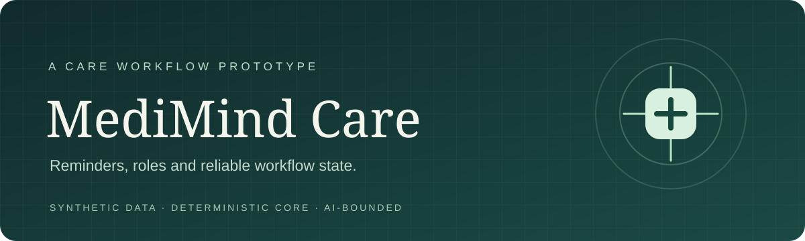
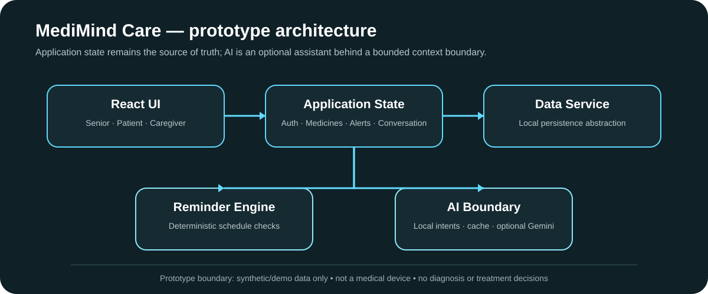

<p align="center"></p>

<p align="center">
  <a href="https://medimind-seven.vercel.app/"><strong>OPEN LIVE PROTOTYPE ↗</strong></a>
  &nbsp;·&nbsp;
  <a href="docs/medimind-architecture.svg">ARCHITECTURE</a>
  &nbsp;·&nbsp;
  <a href="SECURITY.md">SECURITY</a>
  &nbsp;·&nbsp;
  <a href="CONTRIBUTING.md">CONTRIBUTING</a>
</p>

<p align="center">
  
  
  
</p>

# A calmer interface for care workflows.

MediMind Care is an **AI-assisted medication-reminder and health-workflow prototype** built around role-specific experiences, deterministic reminder state, accessible interactions, synthetic data, and strict boundaries around untrusted AI assistance.

> **Project status — completed and frozen.** This repository is a hardened, reproducible prototype for public inspection. Clinical or production-health use is explicitly out of scope.

## At a glance

| | |
|---|---|
| **Experience** | Senior, patient, and caregiver modes |
| **Core principle** | Reminder and workflow state stays deterministic |
| **Data** | Synthetic/demo data only |
| **AI boundary** | Optional assistance; never authoritative |
| **Deployment** | [medimind-seven.vercel.app](https://medimind-seven.vercel.app/) |

## The experience

- **Senior** — simplified controls and medication reminders.
- **Patient** — medication tracking and assistant interaction.
- **Caregiver** — synthetic alerts and overview workflows.

## System design



```text
React UI
   ↓
Application State
   ↓
Deterministic Reminder Layer
   ↓
Local / Demo Data

Optional AI assistance remains bounded and non-authoritative.
```

## Engineering baseline

- Node 22 development and CI baseline
- Deterministic production-build validation
- Playwright browser regression smoke suite
- Chromium installation in CI for browser validation
- CodeQL JavaScript analysis and Dependabot monitoring
- Explicit environment and credential hygiene
- Deployment security headers
- React 18 / Vite 6 application stack

## Safety is an architectural constraint

**MediMind is not a medical device and is not clinical software.** It does not provide diagnosis, treatment decisions, emergency guidance, or clinical authority.

- No real patient records or credentials.
- Synthetic/demo data only.
- AI output is untrusted.
- Reminder and workflow state remains deterministic.
- Clinical use is explicitly out of scope.

These constraints are part of the engineering design, not optional documentation. The hosted demo is for prototype inspection only; do not enter real patient information or credentials.

## Run locally

```bash
npm install
npm run dev
npm run build
npm run test:e2e
```

For local development, copy `.env.example` to `.env`. The public browser build uses mock/local fallback mode. Remote Gemini, OpenAI, and Anthropic calls are disabled until authenticated, rate-limited server-side endpoints are implemented. Never place provider credentials in `VITE_*` variables: Vite embeds them into browser assets.

## Security

The deployment includes defensive HTTP headers: HSTS, content-type protection, frame protection, referrer policy, and a restrictive Permissions Policy.

See [SECURITY.md](SECURITY.md). Never commit API keys, private health information, patient records, session data, or other secrets.

## Contributing

Maintenance contributions are welcome when they improve correctness, accessibility, security, reproducibility, documentation, or dependency hygiene while preserving the safety boundary.

See [CONTRIBUTING.md](CONTRIBUTING.md).

## License

MIT — see [LICENSE](LICENSE).
